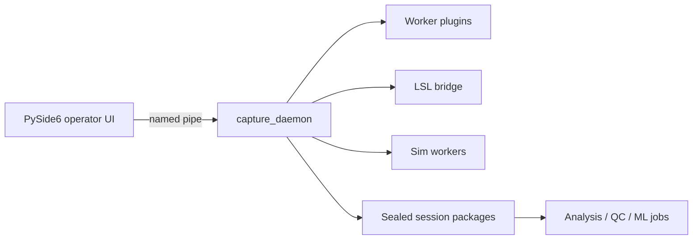

# CaptureSuite

Windows-first multimodal research capture platform: a daemon, versioned worker
plugins, sealed session packages, and a PySide6 operator UI.

> **Live acquisition:** Windows 10 21H2+ x64 for v1.0. The plugin contract is
> process + named-pipe based. Offline analysis also runs on Linux; it does not
> connect to the capture daemon.

Linux developers can build and test the portable core/storage libraries and
`session_doctor`; see [Building on Linux](docs/BUILDING-LINUX.md) for the exact
scope and native checks.

## Who it's for

Researchers and lab engineers who need **structured multimodal capture** on Windows:
a long-running daemon, drop-in worker plugins (C++ or Python), and **sealed session
packages** for downstream QC / features / pose / ML — without rewriting the core
capture path for every device.

## What you get

- **Daemon** — QPC clock, session FSM, recovery, named-pipe control plane
- **Plugins** — drop in a `plugin.json` + worker executable (C++ or Python SDK)
- **Sim** — develop and demo without hardware
- **LSL bridge** — record any Lab Streaming Layer outlet with zero vendor code
- **Analysis** — QC, features, pose/kinematics, ML bundle jobs on sealed packages

## Architecture (sketch)



## Inspect a synthetic QC result first

After setting up the documented Python 3.12 analysis dependencies, run from the
repository root (the parent directory must exist; choose a NEW output path):

```powershell
py -3.12 tools/demo_qc.py ../capturesuite-qc-demo
```

This runs the real offline QC engine against a copy of the bundled **synthetic**
EMG/IMU mini-session. It needs no capture daemon, GUI, physical device, account,
or patient data. The output contains `DEMO-RECEIPT.json` and an inspectable HTML
and JSON report under
`synthetic-demo.mmsession/processing/jobs/demo-qc/reports/`.

The two bundled MCAP segments are 28-byte text placeholders, not recorded
samples. This demo's duration, sampling rates, listed segment counts, and green
QC labels come from the supplied package and stream descriptors; the demo does
not decode samples or establish signal quality.

The example checks original-fixture and copied raw-source hashes, rejects an
existing output directory, and preserves failure output for diagnosis. It does
not establish hardware performance, clinical validity, or full product readiness.
Tests: `tests/analysis/test_offline_demo.py`.

For the pre-release **Linux x86-64 standalone offline analysis executable**
(no Python installation required), [download version 0.1.5](https://github.com/Jacob-Met/CaptureSuite/releases/tag/offline-analysis-v0.1.5-measurement-context)
and follow [Offline Analysis Linux](docs/OFFLINE_ANALYSIS_LINUX.md).
Selected numeric exports retain readable method and sample-support context;
mistyped source IDs fail before replacing saved analysis. The release includes
real handoff screenshots and a short screen recording.

## Validate recorded MCAP bytes in a sealed session

Normal `qc` is fast **package and gap metadata QC**: a source labelled `ok`
does not mean its sensor values were decoded. For a session containing actual
MCAP data, opt into payload inspection:

```powershell
py -3.12 tools/run_analysis.py qc .\my-session.mmsession --inspect-payloads --strict-warnings
```

The offline report's **Streams** table and `reports/qc.json` now distinguish
these states:

- `not_requested`: normal metadata-only run; no payload read.
- `numeric_samples_checked`: all data MCAPs parsed, and all supported
  `generic.numeric_batch/1` frames decoded and checked for finite sample
  values, consistent channels and valid in-batch timestamp order.
- `emg_samples_checked`: decoded `emg.batch/1` channel matrices verified for
  byte length, stable channel IDs and finite float32 measurements. Exposes
  observed constant channels without diagnosing electrode condition.
- `imu_frames_checked`: decoded `imu.frame/1` frames verified for sensor
  identity and finite acceleration, gyroscope and quaternion values. Exposes
  sensor IDs, per-observed-sensor frame presence and zero-quaternion observations
  without asserting calibration. A sensor appearing in only some decoded frames
  now generates a QC warning and makes `--strict-warnings` exit nonzero; sensors
  absent from every frame cannot be inferred from the recording alone.
- `mcap_messages_checked`: MCAP structure/messages parsed for another schema;
  sample values **not** decoded or validated.
- `failed`: unreadable, empty or inconsistent MCAP content; source light
  becomes `fail`, the job completes **with warnings**, and
  `--strict-warnings` exits with code 2.
- `not_applicable`: no data MCAP segments; missing segments are still detected
  separately by existing QC.

Payload inspection needs `mcap` and, for NumericBatch/EMG decoding, NumPy and
protobuf. It streams messages rather than loading a whole capture and never
rewrites raw sources. It does **not** measure signal accuracy, noise,
calibration, true device sampling rate, video pixels or medical validity.
The bundled synthetic demo contains text placeholders, so do not enable
payload inspection on it expecting a clean sample-quality result.

## Compare selected recordings

~~~bash
capturesuite-analysis review FIRST.mmsession SECOND.mmsession --inspect-payloads --output NEW_DIR
~~~

Compare decode coverage, gaps and warnings, then open the original QC reports.
The review is written outside the recordings. See [Compare selected
recordings](docs/QC_PACKAGE_REVIEW.md).

## Export a saved feature selection

Use `capturesuite-analysis export-table JOB_DIR --list` in the Linux offline
release, or `python tools/export_feature_table.py JOB_DIR --list` from source, to
find saved tables and columns. Export a selection to CSV/Parquet with its types,
units, original warnings and job provenance. See [feature table export](docs/FEATURE_TABLE_EXPORT.md).

## Reopen saved analysis in the native desktop

The Analysis workspace opens an existing recording and its saved jobs. Choose a
result by its purpose, time and output counts, inspect complete figures, preview
the actual saved measurements, and export chosen columns in a deliberate order.
CSV and Parquet retain the saved values, types, units and source warnings.

From an installed Python 3.12 desktop analysis environment:

~~~bash
python -m capture_desktop --analysis /path/to/recording.mmsession
~~~

On Linux this offline workspace is the default. On Windows the explicit
`--analysis` option opens it without a live capture connection. See
[native saved analysis](docs/design/ANALYSIS.md#native-saved-analysis-workspace)
for setup, workflow and current limits. The separately published Linux
`capturesuite-analysis` executable is a command-line application.

## Export recorded numeric samples

The [experimental Linux numeric-export release](https://github.com/Jacob-Met/CaptureSuite/releases/tag/numeric-samples-2026-11-10)
contains a standalone executable; no Python installation is required:

```sh
./capturesuite-analysis export-session recording.mmsession exported-samples --modalities numeric --verify
```

This preserves every recorded numeric channel value, exact native timestamps,
separate MCAP clocks and copied gap provenance. Missing native clocks remain
unknown. The maintained desktop's Export dialog offers the same numeric choice;
the downloadable archive contains the Linux CLI, not a packaged desktop.
See [numeric sample export](docs/NUMERIC_SAMPLE_EXPORT.md) for import instructions
and timing limits. Independent actual-release receiving accepted exact data and
malformed-input refusal on generated recordings, not physical instruments.

## Simulation walkthrough (after build prerequisites)

```powershell
# Terminal 1 — build + daemon (once per machine: copy CMakeUserPresets.example.json)
. .\scripts\dev-env.ps1
cmake --preset windows-release
cmake --build build/windows-release --target capture_daemon
.\build\windows-release\daemon\capture_daemon.exe

# Terminal 2 — desktop
cd desktop
& "$env:LOCALAPPDATA\Programs\Python\Python312\python.exe" -m capture_desktop
```

Or use `tools/run-demo.ps1` after a release build.

In the UI: status bar shows **Connected** → **Create Session** → **Rehearse**
or **Start Selected**. Greyed buttons usually mean the daemon is not connected.

## Bring your own device

1. Implement the worker protocol (or subclass `capture_worker.Worker` in Python).
2. Drop `plugins/<your_id>/plugin.json` next to the daemon (or under
   `%LOCALAPPDATA%\CaptureSuite\plugins`).
3. Restart the daemon — sources appear in the Capture rail.

Fast path:

```powershell
.\tools\new_plugin.ps1 -PluginId "lab.force" -DisplayName "Force plate" -Family numeric -Modality force
```

Then paste a template from [docs/prompts/](docs/prompts/) into Cursor.
See [docs/plugins/](docs/plugins/) and
[docs/design/PLUGIN_REGISTRY.md](docs/design/PLUGIN_REGISTRY.md).

## Docs

| Audience | Location |
|----------|----------|
| Product specification | [docs/spec/](docs/spec/) |
| Implementation decisions | [docs/design/](docs/design/) |
| Plugin authors | [docs/plugins/](docs/plugins/) |
| Operators | [docs/operator/](docs/operator/) |
| Contributor rules | [AGENTS.md](AGENTS.md), [CONTRIBUTING.md](CONTRIBUTING.md) |

## License

CaptureSuite application code is **GPL-3.0**. Schemas, the wire protocol
library, the Python worker SDK, and the C++ stub template are **Apache-2.0** so
you can wrap proprietary vendor SDKs in plugins without viral licensing.
Details: [LICENSING.md](LICENSING.md).

## How to cite

See [CITATION.cff](CITATION.cff). A Zenodo DOI will be added on the first
tagged release.

## Maintainer

**[Jacob Metoyer](https://jacobmetoyer.com/)** ([@Jacob-Met](https://github.com/Jacob-Met)) — architecture
and product direction. Independent research software (not an official product of
any university lab unless separately stated).

Payload QC warns when an IMU sensor sample has an all-zero quaternion: orientation is unavailable for that sample, although finite acceleration and gyro values can still be decoded. This exact observation is not a hardware accuracy assessment or a non-unit quaternion tolerance policy.

## Experimental offline native desktop

Inspect finalized recordings, recorded notes/checkpoints/gaps and retained video
without a capture daemon. On Linux with Python 3.12, run
`./scripts/run-desktop-offline.sh --review /path/to/recording.mmsession`.
See [offline desktop review](docs/operator/OFFLINE_DESKTOP_REVIEW.md) for setup,
exact-time semantics and platform limits. Live acquisition remains Windows-only.
